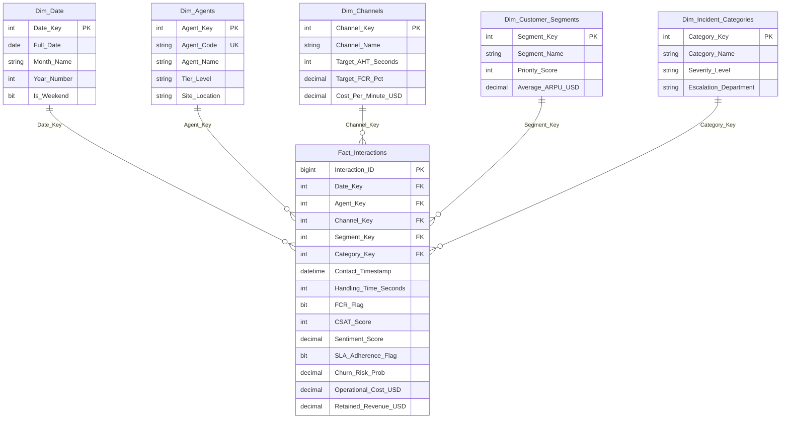

# 📊 Enterprise Telecom BI Warehouse & Executive Analytics Dashboard

[](https://microsoft.com/sql-server)
[](https://duckdb.org)
[](https://python.org)
[](https://chartjs.org)

Plataforma analítica empresarial de Inteligencia de Negocios (BI) para operaciones de Contact Center / BPO de Telecomunicaciones. Implementa un modelo dimensional **Star Schema** (metodología Kimball) en T-SQL (Microsoft SQL Server), almacenamiento analítico en DuckDB/SQLite, y un Dashboard Ejecutivo interactivo en tiempo real con consola de consultas SQL en el navegador.

---

## 🏛️ Modelo Dimensional (Star Schema)



---

## ✨ Características de la Plataforma

- **⚡ Arquitectura Star Schema de Alto Rendimiento:** DDL nativo para Microsoft SQL Server (`schema_sql_server.sql`) con llaves foráneas, índices agrupados/no agrupados, vistas precalculadas (`vw_Executive_KPIs`, `vw_Agent_Performance`, `vw_Channel_Efficiency`) y procedimientos almacenados.
- **🦆 Doble Almacén Analítico (DuckDB & SQLite):** Incluye base de datos columnar en DuckDB (`telecom_bi.duckdb`) para agregaciones OLAP sub-segundo y SQLite (`telecom_bi.db`) para portabilidad inmediata.
- **🖥️ Dashboard Ejecutivo Web:**
  - **KPIs en Vivo:** Volumen total de interacciones, AHT promedio, FCR %, CSAT Score y valor económico retenido de Churn.
  - **Filtros Dinámicos:** Segmentación instantánea por Canal (Voz, Chat, WhatsApp, Escalaciones) y Segmento de Cliente (VIP, Fibra, Postpago, Prepago).
  - **Scorecard de Agentes:** Ranking de productividad, adherencia a SLA y clasificación automática (*Top Performer / Coaching Required*).
  - **Consola SQL en el Navegador:** Ejecución interactiva de sentencias analíticas `SELECT` con visualización tabular instantánea.
- **📂 Exportación Power BI Ready:** Carpeta `data_export/` con archivos CSV estructurados (`Fact_Interactions.csv`, `Dim_*.csv`) listos para importar a Power BI Desktop, Tableau o Excel.

---

## 🚀 Puesta en Marcha Rápida

### 1. Clonar el repositorio
```bash
git clone https://github.com/elburgos2000/telecom-bi-warehouse-dashboard.git
cd telecom-bi-warehouse-dashboard
```

### 2. Generar el Warehouse y los datos maestros (12,000 interacciones)
```bash
python build_and_seed_warehouse.py
```

### 3. Iniciar el Dashboard Ejecutivo y la API Analítica
```bash
python server.py
```
Abrir en el navegador: [http://localhost:8085](http://localhost:8085)

---

## 🗄️ Despliegue en Microsoft SQL Server

Para desplegar en una instancia de SQL Server (Local, Azure SQL o Docker):
```bash
sqlcmd -S localhost -U sa -P 'TuPasswordFuerte123' -i schema_sql_server.sql
```
O abrir y ejecutar `schema_sql_server.sql` en **SQL Server Management Studio (SSMS)** o **Azure Data Studio**.

---

## 👨‍💻 Autor

**Brayan Burgos Palomino**  
- **Rol:** Software Engineer & BI Analyst  
- **GitHub:** [@elburgos2000](https://github.com/elburgos2000)  
- **Email:** [motocrossloco@gmail.com](mailto:motocrossloco@gmail.com)  
- **Ubicación:** Bogotá, Colombia  
